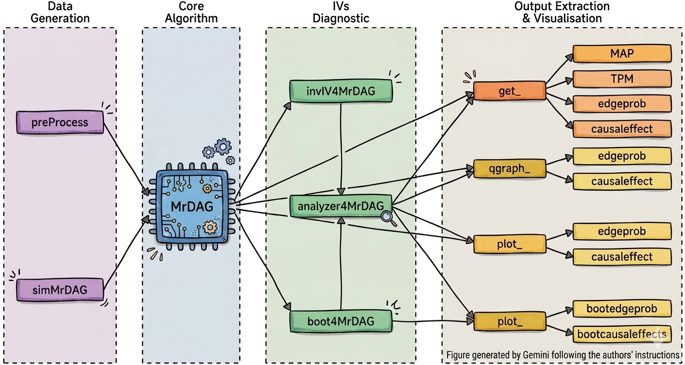

# MrDAGSuite: Fully automated Bayesian causal graphical analysis of multiple exposures and outcomes with genetic anchors

This R package (version: **0.1.0**) extends the [**MrDAG**](https://github.com/lb664/MrDAG) package ([Zuber et al., 2025](https://doi.org/10.1016/j.ajhg.2025.03.005)), a Bayesian two-sample summary-level Mendelian randomization (MR) method which explicitly models dependency relations within the exposures, the outcomes and between them to improve the estimation of genetically predicted effects, with six major advances:

<ul>
    <li> <b>Data generation</b>: a customisable preprocessing script (<code>inst/scripts/MrDAG_data_preprocessing</code>),
    which users can modify to suit their own data, generates the summary-level IVW data format required by
    <b>MrDAGSuite</b> directly from GWAS data repositories, and <code>simMrDAG</code> simulates data from a user-specified
    DAG topology;
    <li> <b>Sample-overlap correction</b>: the sample overlap between the GWAS, which makes the measurement errors of the traits correlated, is corrected through the argument <code>gencov</code>, a list with the sample-overlap covariances between the traits for each IV, estimated by linkage disequilibrium (LD) Score Regression in the preprocessing script;
    <li> <b>Correlated IVs</b>: the linkage disequilibrium (LD) correlation matrix between the IVs is used to whiten
    the summary statistics, so that correlated IVs can be included in the analysis;
    <li> <b>Fully automated analysis</b>: <code>analyzer4MrDAG</code> integrates DAG structure
    learning, invalid IV detection (<code>invIV4MrDAG</code>) and bootstrap estimation of the
    genetically predicted effects to overcome weak-IV bias (<code>boot4MrDAG</code>) in a single function call;
    <li> <b>Expanded output extraction and visualisation</b>: new <code>get_</code>,
    <code>qgraph_</code> and <code>plot_</code> functions extract and visualise the Maximum
    A Posteriori (MAP) DAG, Threshold Posterior Model (TPM), Posterior Edge
    Inclusion Probabilities (PEIPs), genetically predicted effects with credible intervals, bootstrap edge frequencies and
    bootstrap genetically predicted effects;
    <li> <b>C++ implementation</b>: core MCMC routines are re-implemented via <b>Rcpp</b> and
    <b>RcppArmadillo</b>, delivering a 10-fold or greater runtime reduction over the original
    pure R <b>MrDAG</b> implementation.
</ul>

Similarly to MrDAG, **MrDAGSuite** assumes that the directionality of the effects between the exposures and the outcomes is known, i.e., the exposures can only be potential causes of the outcomes and no reverse causation is allowed.

Three data sets are included in the R package. Each is a list with two elements: <code>data</code>, the summary-level IVW statistics (IVs in the rows, traits in the columns, outcomes first), and <code>gencov</code>, the sample-overlap covariances between the traits for each IV.
<ul>
    <li> <b>CardioNHS_data</b>: summary-level IVW statistics for 1,540 IVs, with five cardiovascular disease outcomes (Atrial Fibrillation, Coronary Artery Disease, Cardioembolic Stroke, Heart Failure, Peripheral Artery Disease) and ten cardiometabolic exposures (ApoA, ApoB, BMI, HDL, LDL, Physical Activity, Smoking, SBP, Type 2 Diabetes, Triglycerides) (<a href="https://doi.org/10.1016/j.ajhg.2023.06.005">Zuber et al., 2023</a>);
    <li> <b>LBT2MD_data</b>: summary-level IVW statistics for 708 IVs, six lifestyle and behavioural traits (exposures) and seven mental health phenotypes (outcomes) (<a href="https://doi.org/10.1016/j.ajhg.2025.03.005">Zuber et al., 2025</a>);
    <li> <b>MD2LBT_data</b>: 470 IVs in the reverse direction, with mental health phenotypes as exposures and lifestyle and behavioural traits as outcomes (<a href="https://doi.org/10.1016/j.ajhg.2025.03.005">Zuber et al., 2025</a>).
</ul>

## Installation

1.  Install the [**pak**](https://pak.r-lib.org/) package from **CRAN**. Invoke R and then type

    ```r
    install.packages("pak")
    ```

2.  Install the **MrDAGSuite** package from GitHub by typing

    ```r
    pak::pak("lb664/MrDAGSuite")
    ```

3.  Finally, load the **MrDAGSuite** package

    ```r
    library("MrDAGSuite")
    ```

## Installation notes

**C++ compiler.** **MrDAGSuite** contains compiled C++ code (via **Rcpp**) and **RcppArmadillo**, so a compiler is needed when it is installed from GitHub: [Rtools](https://cran.r-project.org/bin/windows/Rtools/) on Windows, the Xcode command line tools on macOS (`xcode-select --install` in a terminal) and `g++` on Linux.

## Example 1: MrDAG — Cardiometabolic risk factors to cardiovascular disease outcomes

The first example runs the core MCMC algorithm to explore the DAG structure between 10 cardiometabolic exposures (ApoA, ApoB, BMI, HDL, LDL, PA, SMK, SBP, T2D, TG) and 5 cardiovascular disease outcomes (AF, CAD, CES, HF, PAD), using the `CardioNHS_data` summary-level data set. After loading the data

        data(CardioNHS_data)

which contains the IVW statistics, `CardioNHS_data$data`, and the sample-overlap covariances, `CardioNHS_data$gencov`,

the indices (columns) of the traits that define the outcomes and exposures in `CardioNHS_data$data` are provided in a list object  

        MRconstraint <- NULL
        MRconstraint$Y_idx <- 1 : 5    # Cardiovascular disease outcomes (AF, CAD, CES, HF, PAD)
        MRconstraint$X_idx <- 6 : 15   # Cardiometabolic risk factor exposures (ApoA, ApoB, BMI, HDL, LDL, PA, SMK, SBP, T2D, TG)

the prior edge inclusion probability is set as in Zuber et al. (2025), one expected edge per node, $2 / (q + p - 1)$ for $q + p$ traits,

        pp_edge <- 2 / (ncol(CardioNHS_data$data) - 1)

and the **MrDAG** core algorithm is run to generate posterior samples

        output <- MrDAG(data = CardioNHS_data$data, gencov = CardioNHS_data$gencov,
                        niter = 60000, burnin = 10000, thin = 10,
                        pp = pp_edge, tempMax = 10,
                        MRconstraint = MRconstraint,
                        fileName = NULL)

**Warning**: the MCMC parameters above are for illustration purposes only. For reliable posterior inference on `CardioNHS_data` we recommend `niter = 1200000`, `burnin = 100000` and `thin = 100`, as used in Bottolo et al. (2026, submitted).

The posterior edge inclusion probabilities (PEIPs) are then visualised with a user-defined trait ordering: outcomes first (CAD, PAD, HF, AF, CES) followed by exposures (ApoA, HDL, ApoB, LDL, PA, SMK, BMI, SBP, T2D, TG)

        ord <- c(c(2, 5, 4, 1, 3), c(6, 9, 7, 10, 11, 12, 8, 13, 14, 15))
        plot_postEdgeProb(output, ord = ord, fileName = "CardioNHS_postEdgeProb")

and genetically predicted effects with 90% credible intervals are plotted with

        plot_genPredEffects(output, ord = ord, CI = 0.9,
                           fileName = "CardioNHS_genPredEffects_w_CIs")

The convergence of the chain is checked with

        plot_convdiagnostic(output, fileName = "CardioNHS_convDiagnostic")

and the network versions of the results, with edge thickness proportional to the PEIP or to the genetically predicted effect, are drawn with

        qgraph_postEdgeProb(output, threshold = 0.5, legend = TRUE, fileName = "CardioNHS_qgraph_postEdgeProb")
        qgraph_genPredEffects(output, threshold = 0.01, legend = TRUE, fileName = "CardioNHS_qgraph_genPredEffects")

The same results are available as numerical output: the PEIPs, the genetically predicted effect of one exposure (here ApoB, column 7) on one outcome (here CAD, column 2), and the effects of all exposures on all outcomes with 95% credible intervals, are obtained with

        PEIP <- get_postEdgeProb(output, ord = ord)
        genPredEffect <- get_genPredEffect(output, 2, 7)
        genPredEffects <- get_genPredEffects(output, CI = 0.95, ord = ord)

## Example 2: Invalid IV detection

The second example illustrates invalid IV detection using `invIV4MrDAG` on `CardioNHS_data`. The **MrDAG** core algorithm is first run

        MRconstraint <- NULL
        MRconstraint$Y_idx <- 1 : 5    # Cardiovascular disease outcomes
        MRconstraint$X_idx <- 6 : 15   # Cardiometabolic risk factor exposures

        pp_edge <- 2 / (ncol(CardioNHS_data$data) - 1)

        output <- MrDAG(data = CardioNHS_data$data, gencov = CardioNHS_data$gencov,
                        niter = 60000, burnin = 10000, thin = 10,
                        pp = pp_edge, tempMax = 10,
                        MRconstraint = MRconstraint,
                        fileName = NULL)

and invalid IVs are then detected via leave-one-out marginal likelihood comparisons

        invIV_output <- invIV4MrDAG(data = CardioNHS_data$data, output, gencov = CardioNHS_data$gencov)

The names of the detected invalid IVs can be retrieved with

        invIV_output$invalidIV   # names of invalid IVs

## Example 3: Fully automated pipeline: analyzer4MrDAG

The third example demonstrates the fully automated `analyzer4MrDAG` pipeline, which integrates DAG learning, invalid IV detection and bootstrap estimation of the genetically predicted effects for weak IVs in a single call

        MRconstraint <- NULL
        MRconstraint$Y_idx <- 1 : 5    # Cardiovascular disease outcomes
        MRconstraint$X_idx <- 6 : 15   # Cardiometabolic risk factor exposures

        pp_edge <- 2 / (ncol(CardioNHS_data$data) - 1)

        output <- analyzer4MrDAG(data = CardioNHS_data$data, gencov = CardioNHS_data$gencov,
                                 ninvIV = 5, nboot = 10,
                                 niter = 20000, burnin = 10000, thin = 10,
                                 pp = pp_edge, tempMax = 10,
                                 MRconstraint = MRconstraint,
                                 fileName = NULL)

Here `ninvIV = 5` specifies the number of sequential MCMC runs used to detect invalid IVs, where, at each run, invalid IVs are detected and removed before retesting for invalid IVs in the next run, and `nboot = 10` the number of bootstrap replicates for the estimation of the genetically predicted effects (both reduced for illustration, see warning below).

**Warning**: the MCMC parameters above are for illustration purposes only. For reliable posterior inference on `CardioNHS_data` we recommend `niter = 200000`, `burnin = 100000`, `thin = 100` and `nboot = 100`, as used in Bottolo et al. (2026, submitted).

Results from all three stages are accessible via named list elements. The Maximum A Posteriori (MAP) DAG, i.e., the DAG with the highest posterior probability visited during MCMC after removing invalid IVs, and the Threshold Posterior Model (TPM), i.e., the graph retaining only edges whose PEIP exceeds a given threshold, are obtained with

        ord <- c(c(2, 5, 4, 1, 3), c(6, 9, 7, 10, 11, 12, 8, 13, 14, 15))
        MAP <- get_MAP(output$outputMrDAG, ord = ord,
                       model = "CPDAG", sortby = "logMargLik")
        TPM <- get_TPM(output$outputMrDAG, ord = ord)

Bootstrap genetically predicted effects with credible intervals are visualised with

        plot_bootGenPredEffects(output$outputBoot, ord = ord, CI = 0.9,
                               fileName = "CardioNHS_bootGenPredEffects_w_CI")

and the bootstrap edge frequencies with

        plot_bootEdgeFreq(output$outputBoot, ord = ord, fileName = "CardioNHS_bootEdgeFreq")

The bootstrap stage can also be run on its own with `boot4MrDAG`, which takes the same arguments of `MrDAG` and the number of bootstrap replicates `nboot`

        boot <- boot4MrDAG(data = CardioNHS_data$data, gencov = CardioNHS_data$gencov, nboot = 10,
                           niter = 20000, burnin = 10000, thin = 10,
                           pp = pp_edge, tempMax = 10,
                           MRconstraint = MRconstraint,
                           fileName = NULL)

## Example 4: Data simulation

The fourth example simulates two-sample summary-level data with `simMrDAG`, five outcomes and 15 exposures with 100 IVs, and checks how well **MrDAG** recovers the simulated structure

        q <- 5
        p <- 15
        simData <- simMrDAG(nRep = 1, q = q, p = p, nSubject_X = 50000,
                            graph_Y = "dir", graph_X = "dir",
                            fileName = NULL, seed = 28061971)

        MRconstraint <- NULL
        MRconstraint$Y_idx <- 1 : q
        MRconstraint$X_idx <- q + (1 : p)

        output <- MrDAG(data = cbind(simData$betaHat_Y, simData$betaHat_X),
                        niter = 150000, burnin = 50000, thin = 50, pp = 0.1, tempMax = 20,
                        MRconstraint = MRconstraint, fileName = NULL, seed = 28061971)

        PEIP <- get_postEdgeProb(output)

## Data preprocessing

A customisable preprocessing R script is provided in

        system.file("scripts", "MrDAG_data_preprocessing.R", package = "MrDAGSuite")

This script generates the summary-level IVW data format required by **MrDAGSuite** directly from GWAS data repositories, together with the sample-overlap covariances between the traits (`gencov`), estimated by LD Score Regression. Everything the user has to provide, i.e., the traits, their sample sizes and the exposures and outcomes, is declared in one configuration file per analysis, installed in the same folder (for example `MrDAG_data_preprocessing_V0.1.0_CardioNHS_Forward_config.R`).

The script is installed as plain R code, so users can copy it and modify it to suit their own data and needs: the data sources, the selection and clumping of the instruments, the traits and their sample sizes, and the exposures and outcomes are all set in the configuration file or in the script itself, and the script can be adapted to other analyses.

The heterogeneity in file format, delimiter, and compression across GWAS data repositories motivates the automatic data‑retrieval procedure implemented in the R script. It also identifies the variant identifier and the relevant statistical columns in any input file, without requiring user intervention beyond specifying the trait URL or file path.

## Vignette

A complete example, from the configuration of the preprocessing to the plot of the results, is given in the vignette `MrDAGSuite-CardioNHS`. It is installed with the package. Open it with

```r
vignette("MrDAGSuite-CardioNHS", package = "MrDAGSuite")
```

The source of the vignette is also available in the repository, in `vignettes/MrDAGSuite-CardioNHS.Rmd`.

## Issues

To report an issue, please use the **MrDAGSuite** issue tracker at [BugReports](https://github.com/lb664/MrDAGSuite/issues)

## License and authors

This software uses the GPL v2 license, see [License](https://github.com/lb664/MrDAGSuite/blob/main/LICENSE). Authors and copyright are provided in [Description](https://github.com/lb664/MrDAGSuite/blob/main/DESCRIPTION)
