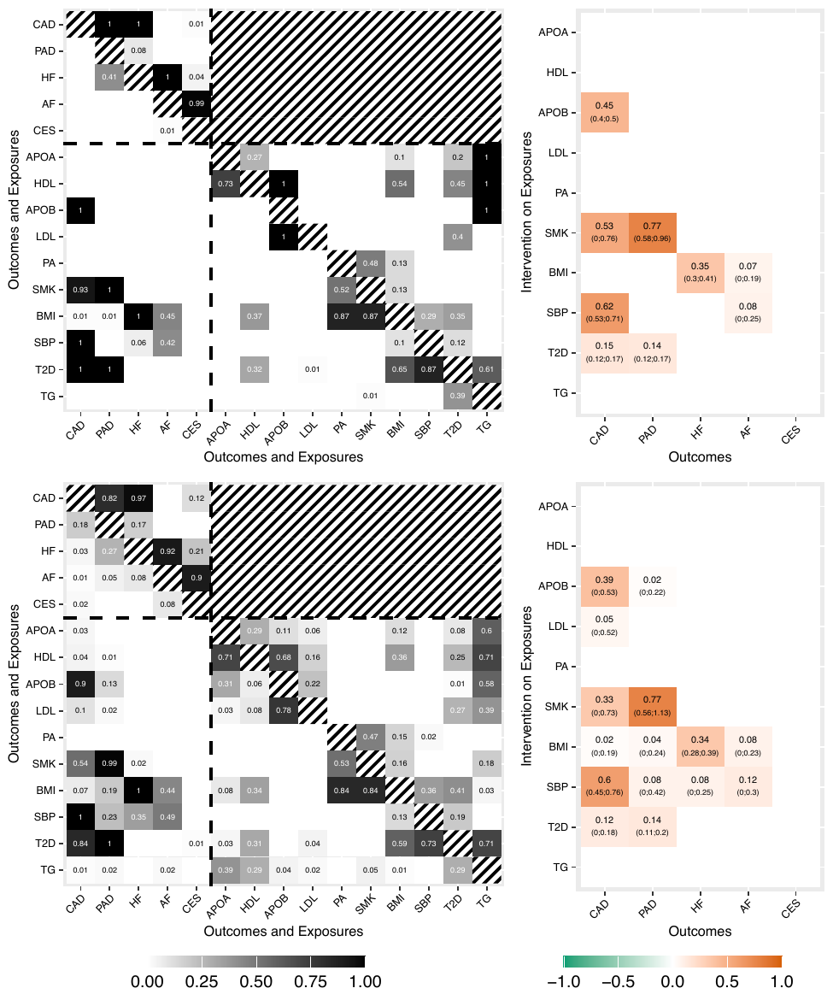

```{r setup, include = FALSE}
knitr::opts_chunk$set(collapse = TRUE, comment = "#>")
```


This vignette presents a complete analysis with MrDAGSuite, from the declaration of the traits to the generation of the results. The example is the **CardioNHS Forward** analysis of Zuber et al. (2023): the genetically predicted effects of ten cardiometabolic and lifestyle exposures (ApoA: apolipoprotein A; ApoB: apolipoprotein B; BMI: body mass index; HDL: high-density lipoprotein cholesterol; LDL: low-density lipoprotein cholesterol; PA: physical activity; SMK: lifetime smoking index; SBP: systolic blood pressure; T2D: type 2 diabetes; TG: triglycerides) on five cardiovascular outcomes (AF: atrial fibrillation; CAD: coronary artery disease; CES: cardioembolic stroke; HF: heart failure; PAD: peripheral artery disease), using summary statistics from genome-wide association studies (GWAS).

The analysis has five steps:

1. Set up the configuration file of the preprocessing pipeline.
2. Run the pipeline and the MrDAG algorithm.
3. Derive the post-processing values (posterior edge inclusion probabilities, graphs, genetically predicted effects).
4. Plot the results.
5. Interpret the results.

All paths are relative to a project directory, which is set once at the start of each session.

```{r chunk01, eval = FALSE}
setwd("path/to/project/")   # project directory
```

## 0. Before you start

Install the package and load it.

```{r chunk02, eval = FALSE}
# install.packages("remotes")
remotes::install_github("lb664/MrDAGSuite")
library(MrDAGSuite)
```

The preprocessing pipeline needs, in addition, PLINK (found automatically through the `genetics.binaRies` package), the 1000 Genomes reference panel of European ancestry and the reference files for LD Score Regression (LDSC). They are downloaded automatically into the directory declared as `ref_dir` below if they are not already there. The pipeline checks for the other required R packages and installs those that are missing.

If the user wants to try the algorithm directly, the package contains the result of the preprocessing step as the dataset `CardioNHS_data`, a list with the data (`CardioNHS_data$data`) and the sample-overlap matrices (`CardioNHS_data$gencov`). In that case skip Section 1 and go to Section 2, replacing `MrDAG_data` and `gencov` by these two elements.

## 1. Set up the configuration file

Everything the user has to provide is declared in one file, `MrDAG_data_preprocessing_V0.1.0_CardioNHS_Forward_config.R`. It contains the directories, the analysis parameters, where each trait comes from, the sample sizes of the GWAS and the names of the exposures and outcomes. Nothing else needs to be edited to run the pipeline. The pipeline is also customisable: it is installed as plain R code, so you can copy the scripts and modify them to suit your own data, for example the data sources, the selection and clumping of the instruments, or the traits.

### 1.1 Directories and analysis parameters

```{r chunk03, eval = FALSE}
# --- Working directory: the directory with the pipeline scripts and the data (by default the current one) ---
work_dir   <- getwd()

# --- Directories ---
gwas_dir   <- "gwas_data/CardioNHS"         # where the raw GWAS files are stored
ref_dir    <- "ld_reference"                # where the 1000 Genomes LD reference panel is stored
output_dir <- "Output/CardioNHS/Forward"    # where all output files are written

ldsc_munged_dir <- file.path(gwas_dir, "ldsc_munged")    # harmonised files used by LD Score Regression
ldsc_ref_dir    <- file.path(ref_dir, "ldsc_reference")  # LD scores and HapMap3 SNP list

# --- Analysis parameters ---
clump_r2  <- 0.01    # LD clumping r2 threshold
p_thresh  <- 5e-8    # genome-wide significance threshold for an instrument
clump_kb  <- 10000   # clumping window (kb)
clump_p   <- 0.99    # clumping p-value threshold (all variants are considered)
```

A variant is kept as an instrument if it is genome-wide significant ($p < 5 \times 10^{-8}$) for at least one exposure. The instruments are then clumped at $r^2 = 0.01$ in a window of 10,000 kb, so that they are practically independent. This is why the algorithm below needs no LD matrix.

### 1.2 Where each trait comes from

Each trait is declared by a name and the address of its summary statistics. Traits with an address are downloaded automatically. Traits with an empty string are *manual*: the file is placed in `gwas_dir`, with a file name starting with the trait name (for example `CAD*.*`).

```{r chunk04, eval = FALSE}
all_traits <- list(
  # Broad UKB / Neale Lab (downloaded automatically)
  ApoA = "https://broad-ukb-sumstats-us-east-1.s3.amazonaws.com/round2/additive-tsvs/30630_irnt.gwas.imputed_v3.both_sexes.varorder.tsv.bgz",
  ApoB = "https://broad-ukb-sumstats-us-east-1.s3.amazonaws.com/round2/additive-tsvs/30640_irnt.gwas.imputed_v3.both_sexes.varorder.tsv.bgz",
  BMI  = "https://broad-ukb-sumstats-us-east-1.s3.amazonaws.com/round2/additive-tsvs/21001_irnt.gwas.imputed_v3.both_sexes.tsv.bgz",
  HDL  = "https://broad-ukb-sumstats-us-east-1.s3.amazonaws.com/round2/additive-tsvs/30760_irnt.gwas.imputed_v3.both_sexes.varorder.tsv.bgz",
  LDL  = "https://broad-ukb-sumstats-us-east-1.s3.amazonaws.com/round2/additive-tsvs/30780_irnt.gwas.imputed_v3.both_sexes.varorder.tsv.bgz",
  SBP  = "https://broad-ukb-sumstats-us-east-1.s3.amazonaws.com/round2/additive-tsvs/4080_irnt.gwas.imputed_v3.both_sexes.tsv.bgz",
  TG   = "https://broad-ukb-sumstats-us-east-1.s3.amazonaws.com/round2/additive-tsvs/30870_irnt.gwas.imputed_v3.both_sexes.varorder.tsv.bgz",

  # GWAS Catalog harmonised files (downloaded automatically)
  HF   = get_ebi_url("GCST009541"),
  CES  = "http://ftp.ebi.ac.uk/pub/databases/gwas/summary_statistics/GCST90104001-GCST90105000/GCST90104541/harmonised/GCST90104541.h.tsv.gz",

  # Manual traits: place the file in gwas_dir, with a name starting with the trait name
  AF   = "",
  PA   = "",
  CAD  = "",
  PAD  = "",
  SMK  = "",
  T2D  = ""
)
```

`get_ebi_url()` is a small helper, defined in the same file, that builds the address of a harmonised GWAS Catalog file from its accession number.

### 1.3 Sample sizes

This step is relevant only if LD Score Regression (LDSC) is performed to estimate the sample overlap between the traits. If the sample information is not declared for all the traits, the pipeline skips LDSC and assumes that the GWAS do not overlap. The pipeline needs the size of each GWAS to estimate the sample overlap between the traits with LDSC. For a quantitative trait it is the sample size `N`, and `OLS = TRUE` tells the pipeline that the effect sizes come from a linear regression. For a binary trait it is the number of cases and controls and the prevalence in the population, which is used to put the heritability on the liability scale.

```{r chunk05, eval = FALSE}
trait_sample_info <- list(
  ApoA = list(type = "quant",  N = 317756, OLS = TRUE),
  ApoB = list(type = "quant",  N = 317756, OLS = TRUE),
  BMI  = list(type = "quant",  N = 359983, OLS = TRUE),
  HDL  = list(type = "quant",  N = 317788, OLS = TRUE),
  LDL  = list(type = "quant",  N = 317778, OLS = TRUE),
  SBP  = list(type = "quant",  N = 317754, OLS = TRUE),
  TG   = list(type = "quant",  N = 318024, OLS = TRUE),
  PA   = list(type = "quant",  N = 608595, OLS = TRUE),
  SMK  = list(type = "quant",  N = 462690, OLS = TRUE),

  T2D  = list(type = "binary", cases = 74124, controls = 824006, population_prevalence = 0.105),
  AF   = list(type = "binary", cases = 60620, controls = 970216, population_prevalence = 0.02),
  CAD  = list(type = "binary", cases = 71602, controls = 260875, population_prevalence = 0.017),
  HF   = list(type = "binary", cases = 47309, controls = 930014, population_prevalence = 0.017),
  PAD  = list(type = "binary", cases = 31307, controls = 211753, population_prevalence = 0.038),
  CES  = list(type = "binary", cases = 10804, controls = 1234808, population_prevalence = 0.003)
)
```

### 1.4 Exposures and outcomes

The choice of the exposures and the outcomes is determined by the research question. They are character vectors of names from `all_traits`. Swapping the two vectors gives the Reverse analysis, from the cardiovascular diseases to the risk factors (the user can try it, but it is not performed here)

```{r chunk06, eval = FALSE}
Exposures <- c("ApoA", "ApoB", "BMI", "HDL", "LDL", "PA", "SMK", "SBP", "T2D", "TG")
Outcomes  <- c("AF", "CAD", "CES", "HF", "PAD")
```

### 1.5 Run the pipeline

The configuration file and the pipeline scripts are installed with the package, in the folder `scripts`. They are plain R files that you can modify to suit your own analysis. Copy them to a working directory of your choice, set it as the current directory and run the entry script. The entry script loads the configuration file and then the pipeline, which downloads the missing files, harmonises the alleles, selects and clumps the instruments (IVs), estimates the sample overlap between all traits with LDSC and writes the objects used below to `output_dir`. By default the data and the output are stored in the working directory (`work_dir <- getwd()` in the configuration file).

```{r chunk04b, eval = FALSE}
scripts <- system.file("scripts", package = "MrDAGSuite")
file.copy(list.files(scripts, full.names = TRUE), "path/to/working/directory")   # any directory of your choice

setwd("path/to/working/directory")
source("MrDAG_data_preprocessing_V0.1.0_CardioNHS_Forward.R")   # loads the configuration file and the pipeline
```

The first run is rather long, since it downloads tens of gigabytes of summary statistics and the reference files. The last file written, `MrDAG_input.RData`, is ready to be passed to the algorithm.

```{r chunk08, eval = FALSE}
load(file.path(work_dir, output_mrdag_input_rdata))   # MrDAG_input.RData in the output folder
ls()
#> [1] "gencov"            "gencovDiagnostics" "MrDAG_data"
#> [4] "MrDAGcheck"        "rs"

dim(MrDAG_data)               # instruments x traits
#> [1] 1540   15
colnames(MrDAG_data)          # outcomes first, then exposures
#>  [1] "AF"   "CAD"  "CES"  "HF"   "PAD"  "ApoA" "ApoB" "BMI"  "HDL"  "LDL"
#> [11] "PA"   "SMK"  "SBP"  "T2D"  "TG"
MrDAGcheck                    # which columns are outcomes (Y_idx) and which are exposures (X_idx)
#> $Y_idx
#> [1] 1 2 3 4 5
#> $X_idx
#>  [1]  6  7  8  9 10 11 12 13 14 15
length(gencov)                # one 15 x 15 sample-overlap matrix per instrument
#> [1] 1540
```

`MrDAG_data` holds the standardised effect estimates of the 1,540 clumped instruments on the 15 traits. `gencov` holds, for every instrument, the sample-overlap covariances between the traits, from LD Score Regression. `MrDAGcheck` tells the algorithm which traits are outcomes and which are exposures, so that edges from the outcomes to the exposures are never allowed. The columns of the data must be ordered with the outcomes first and then the exposures, as the pipeline does: `MrDAG()` stops with an error if the outcome indices (`Y_idx`) do not all precede the exposure indices (`X_idx`).

## 2. Run the MrDAG algorithm

### 2.1 Settings

The prior edge inclusion probability follows Zuber et al. (2025): one expected edge per node, $\pi = 2 / (q + p - 1)$, with $q + p = 15$ traits. The sampler starts at a high temperature that is lowered during the burn-in.

```{r chunk09, eval = FALSE}
pp_edge <- 2 / (ncol(MrDAG_data) - 1)    # edge prior, 0.1429 for 15 traits
```

### 2.2 Running the MrDAG algorithm

The instruments are clumped, so no LD matrix is passed. The sample-overlap correction is switched on by passing `gencov`. A seed makes the run reproducible.

```{r chunk10, eval = FALSE}
output <- MrDAG(data = MrDAG_data, gencov = gencov,
                niter = 1200000, burnin = 100000, thin = 100,
                pp = pp_edge, tempMax = 10,
                MRconstraint = MrDAGcheck,
                fileName = "MrDAG_CardioNHS", filePath = file.path(work_dir, output_dir),
                seed = 28061971)
```

The chain has 1,200,000 iterations, 100,000 of them burn-in, and every 100th is kept, which gives 11,000 sampled graphs. On a laptop the run takes about a minute. For a quick test, `niter = 120000` and `burnin = 10000` runs all the steps below in a few seconds. In a test analysis, this short chain gave the same strong edges as the full chain, and posterior means of the genetically predicted effects that differ from those of the full chain by about 0.01 or less in absolute value (the effects are on the standardised scale, as in Section 6), but the intervals and the weak edges are less stable. The object `output` is also saved in `filePath`.

### 2.3 What the sample-overlap correction changed

Before reading the results, check how large the sample-overlap correction was. The pipeline stores the diagnostics, and the package summarises them.

```{r chunk11, eval = FALSE}
gencovCorrect <- get_gencovCorrect(MrDAG_data, gencov = gencov)
gencovCorrect
```

## 3. Post-processing

All the post-processing functions take the object returned by `MrDAG()`. The argument `ord` is a vector with the column indices of `MrDAG_data`, in the order in which the traits should appear in the results; by default it is the order of the data. The outcomes always come before the exposures: `ord` only changes the order within the outcomes and within the exposures, for presentation purposes. Here the outcomes (columns 1 to 5: AF, CAD, CES, HF, PAD) are shown in the order CAD, PAD, HF, AF, CES (indices 2, 5, 4, 1, 3), and the exposures (columns 6 to 15) in the order ApoA, HDL, ApoB, LDL, PA, SMK, BMI, SBP, T2D, TG (indices 6, 9, 7, 10, 11, 12, 8, 13, 14, 15), so that the tables and the figures follow the same order.

```{r chunk12, eval = FALSE}
ord <- c(c(2, 5, 4, 1, 3), c(6, 9, 7, 10, 11, 12, 8, 13, 14, 15))
```

### 3.1 Posterior edge inclusion probability (PEIP)

```{r chunk13, eval = FALSE}
PEIP <- get_postEdgeProb(output, ord = ord)
round(PEIP$postEdgeProb, 2)
```

`PEIP$postEdgeProb` is a 15 x 15 matrix. The entry in row `i` and column `j` is the PEIP of an edge between traits `i` and `j`, that is, the proportion of the sampled graphs that contain the edge. The exposures-to-outcomes block is the one of interest.

### 3.2 The threshold posterior model and the most probable graph

The threshold posterior model keeps the edges whose PEIP is at least 0.5. The most probable graph (MAP) is taken among the equivalence classes of graphs (the CPDAGs) that appear in the sample, and the classes can be ranked by their frequency in the sample (`sortby = "freq"`) or by their log marginal likelihood (`sortby = "logMargLik"`).

```{r chunk14, eval = FALSE}
TPM <- get_TPM(output, ord = ord, threshold = 0.5)

MAP <- get_MAP(output, ord = ord, model = "CPDAG", sortby = "logMargLik")
```

### 3.3 Genetically predicted effects

The genetically predicted effect of an exposure on an outcome is the effect on the outcome of an intervention on the exposure, averaged over the sampled graphs (Bayesian model averaging). For one exposure and one outcome:

```{r chunk15, eval = FALSE}
# effect of the exposure in column 7 (ApoB) on the outcome in column 2 (CAD)
effect <- get_genPredEffect(output, 2, 7)
```

For all pairs at once, with 95% credible intervals:

```{r chunk16, eval = FALSE}
effects <- get_genPredEffects(output, CI = 0.95, ord = ord, progress = TRUE)

round(effects$genPredEffects, 2)      # posterior mean
round(effects$genPredEffects_LL, 2)   # lower limit of the interval
round(effects$genPredEffects_UL, 2)   # upper limit of the interval
```

A list of the effects whose posterior mean is at least 0.05 in absolute value, with their intervals:

```{r chunk17, eval = FALSE}
est <- effects$genPredEffects
big <- which(abs(est) >= 0.05, arr.ind = TRUE)
data.frame(exposure = rownames(est)[big[, 1]],
           outcome  = colnames(est)[big[, 2]],
           mean     = round(est[big], 2),
           lower    = round(effects$genPredEffects_LL[big], 2),
           upper    = round(effects$genPredEffects_UL[big], 2))
```

## 4. Plot the results

All plot functions save a PDF in `filePath` and use sizes that adapt to the number of traits.

### 4.1 Convergence

```{r chunk18, eval = FALSE}
plot_convdiagnostic(output, fileName = "MrDAG_CardioNHS_convDiagnostic",
                    filePath = "Figures/CardioNHS/")
```

The figure shows the trace of the log marginal likelihood during the whole chain, with the burn-in marked by a grey dotted line, and the trace of the posterior model size, the number of directed edges, after the burn-in. Both should fluctuate around a stable level.

### 4.2 PEIPs and genetically predicted effects

```{r chunk19, eval = FALSE}
# all PEIPs, in the order given by ord
plot_postEdgeProb(output, ord = ord, fileName = "MrDAG_CardioNHS_postEdgeProb_I",
              filePath = "Figures/CardioNHS/")

# only the edges with PEIP at least 0.5
plot_postEdgeProb(output, ord = ord, threshold = 0.5, fileName = "MrDAG_CardioNHS_postEdgeProb_III",
              filePath = "Figures/CardioNHS/")

# genetically predicted effects with 95% credible intervals, effects below 0.01 in absolute value left blank
plot_genPredEffects(output, ord = ord, CI = 0.95, threshold = 0.01,
                   fileName = "MrDAG_CardioNHS_genPredEffects_III",
                   filePath = "Figures/CardioNHS/")
```

### 4.3 Graphs

The same results can be drawn as a network, where the edge thickness shows the PEIP (`qgraph_postEdgeProb`) or the genetically predicted effect (`qgraph_genPredEffects`).

```{r chunk20, eval = FALSE}
qgraph_postEdgeProb(output, threshold = 0.5, legend = TRUE,
                fileName = "MrDAG_CardioNHS_qgraph_postEdgeProb",
                filePath = "Figures/CardioNHS/")

qgraph_genPredEffects(output, threshold = 0.01, legend = TRUE,
                     fileName = "MrDAG_CardioNHS_qgraph_genPredEffects",
                     filePath = "Figures/CardioNHS/")
```

### 4.4 A summary figure

The plot functions can return the figure as a `ggplot` object (`donotplot = TRUE`), which makes it possible to combine them. This is the layout of the summary figure: PEIPs on the left and genetically predicted effects on the right.

```{r chunk21, eval = FALSE}
library(ggplot2)
library(ggpubr)

fig_edges   <- plot_postEdgeProb(output, donotplot = TRUE, ord = ord,
                             plotPar = list(cex.axis = 0.8, cex.lab = 0.8, geom_text.size = 1.8)) +
               theme(legend.key.height = unit(0.25, "cm"))

fig_effects <- plot_genPredEffects(output, donotplot = TRUE, ord = ord, CI = 0.95, threshold = 0.01,
                                  plotPar = list(cex.axis = 0.8, cex.lab = 0.8, geom_text.size = 2.2)) +
               theme(legend.key.height = unit(0.25, "cm"))

pdf("Figures/CardioNHS/Fig_CardioNHS.pdf", width = 7.5, height = 4.8)
print(ggarrange(ggarrange(fig_edges,   ncol = 1, legend = "bottom"),
                ggarrange(fig_effects, ncol = 1, legend = "bottom"),
                ncol = 2, widths = c(1.6, 1)))
dev.off()
```

With the bootstrap (functions `boot4MrDAG()` and `analyzer4MrDAG()`, which repeat the analysis on resampled instruments), a second row with the bootstrap edge frequencies and genetically predicted effects can be added in the same way, using `plot_bootEdgeFreq()` and `plot_bootGenPredEffects()`.

## 5. Further functions

The functions below are not needed to reproduce the results of this vignette, but complete the toolbox of the package.

### 5.1 Invalid instruments

Instruments that act directly on an outcome and not through the exposures are detected by comparing leave-one-out marginal likelihoods. The function takes the output of `MrDAG()` and the data used to obtain it.

```{r chunk22, eval = FALSE}
invIV_output <- invIV4MrDAG(data = MrDAG_data, output, gencov = gencov)
invIV_output$invalidIV    # names of the invalid instruments
```

### 5.2 Bootstrap and the fully automated analysis

`boot4MrDAG()` repeats the analysis on bootstrap samples of the instruments to assess the robustness of the edges and of the genetically predicted effects to weak instruments. `analyzer4MrDAG()` runs the whole analysis, the structure learning, the detection of the invalid instruments and the bootstrap, in one call.

```{r chunk23, eval = FALSE}
boot <- boot4MrDAG(data = MrDAG_data, gencov = gencov, nboot = 100,
                   niter = 200000, burnin = 100000, thin = 100,
                   pp = pp_edge, tempMax = 10, MRconstraint = MrDAGcheck,
                   fileName = NULL, seed = 28061971)

plot_bootEdgeFreq(boot, ord = ord, fileName = "boot4MrDAG_CardioNHS_bootEdgeFreq",
                  filePath = "Figures/CardioNHS/")
plot_bootGenPredEffects(boot, ord = ord, CI = 0.95, threshold = 0.01,
                       fileName = "boot4MrDAG_CardioNHS_bootGenPredEffects",
                       filePath = "Figures/CardioNHS/")

analysis <- analyzer4MrDAG(data = MrDAG_data, gencov = gencov, ninvIV = 5, nboot = 100,
                           niter = 200000, burnin = 100000, thin = 100,
                           pp = pp_edge, tempMax = 10, MRconstraint = MrDAGcheck,
                           fileName = NULL, seed = 28061971)
```

### 5.3 Simulated data

`simMrDAG()` simulates summary-level data from a user-specified graph. The call below simulates five outcomes and 15 exposures with 100 instruments, which can be analysed with `MrDAG()` as above.

```{r chunk24, eval = FALSE}
simData <- simMrDAG(nRep = 1, q = 5, p = 15, nSubject_X = 50000,
                    fileName = NULL, seed = 28061971)
```

## 6. Interpreting the results

The figure below is the result of this analysis, with the 1,540 instruments and the sample-overlap correction. Left column: PEIPs between all traits. Right column: genetically predicted effects of the exposures on the outcomes with 95% credible intervals. Top row: main analysis. Bottom row: bootstrap analysis.

```{r fig2, eval = TRUE, echo = FALSE, out.width = "75%", fig.align = "center"}

```

**Directed edges.** Of the 50 possible directed edges from an exposure to an outcome, seven have a PEIP of at least 0.5: ApoB to CAD (1.00), SBP to CAD (1.00), T2D to CAD (1.00), SMK to CAD (0.93), SMK to PAD (1.00), T2D to PAD (1.00) and BMI to HF (1.00). BMI and SBP have a PEIP of 0.45 and 0.42 for a directed edge to AF, which is weak evidence. No exposure has a directed edge to CES. Most of the other exposures, among them the lipid fractions ApoA, HDL and LDL, and PA and TG, do not have a directed edge to any outcome.

**Genetically predicted effects.** The effects on the standardised scale, with 95% credible intervals, that are at least 0.05 in absolute value are:

| Exposure | Outcome | Posterior mean | 95% credible interval |
|---|---|---|---|
| ApoB | CAD | 0.45 | (0.40, 0.50) |
| SMK | CAD | 0.53 | (0.00, 0.76) |
| SBP | CAD | 0.62 | (0.53, 0.71) |
| T2D | CAD | 0.15 | (0.12, 0.17) |
| SMK | PAD | 0.77 | (0.58, 0.96) |
| T2D | PAD | 0.14 | (0.12, 0.17) |
| BMI | HF | 0.35 | (0.30, 0.41) |
| BMI | AF | 0.07 | (0.00, 0.19) |
| SBP | AF | 0.08 | (0.00, 0.25) |

All the effects are positive. Systolic blood pressure and ApoB have the strongest genetically predicted effects on coronary artery disease, and smoking on peripheral artery disease. Smoking also has an effect on coronary artery disease, but the lower limit of its interval is zero. Body mass index has a clear effect on heart failure and a weak, uncertain one on atrial fibrillation. Type 2 diabetes has a small but clearly non-zero effect on both coronary and peripheral artery disease.

**Sample overlap.** Seven of the ten exposures come from the UK Biobank (UKB), so the GWAS share participants. The estimated sample-overlap correlations between all traits are saved by the pipeline in `LDSC_output.RData`. The correction removes the additive noise that the overlap adds to the estimates. Running the same analysis without the correction gives the same seven directed edges with a PEIP of at least 0.5. The difference is in the weak directed edges: without the correction the PEIPs of the directed edges from BMI and SBP to AF are 0.00 and 0.01, while with it they are 0.45 and 0.42.
